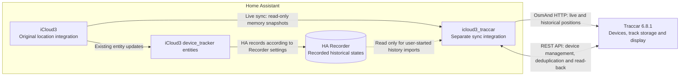

  

# iCloud3 Traccar

[中文说明](README.zh-CN.md) · [User guide](docs/traccar.md) · [Validation record](docs/traccar-test-results.md)

Optional Home Assistant custom integration that sends iCloud3 locations to **Traccar 6.8.1** and imports historical locations from Home Assistant Recorder. It is separate from iCloud3 and disabled by default.

**Preview: `0.1.0-beta.1`.** Automated coverage includes a loopback HTTP server and real Home Assistant / SQLite Recorder. On 2026-10-14 the maintainer confirmed real Traccar, browser UI and HACS installation validation passed. These manual results were supplied by the maintainer; see the validation record for provenance and Actions for automated results.

## Three components and data flow

**iCloud3 locates devices, icloud3_traccar synchronizes locations, and Traccar receives, stores and displays tracks.** The first two are custom integrations running inside Home Assistant; Traccar is a separate service.

- **Live path:** iCloud3 memory → icloud3_traccar → Traccar; Recorder is not involved.
- **History path:** user starts an import → read-only Recorder history → icloud3_traccar → Traccar.
- **Shared identity:** the existing HA registry `device_id` of each iCloud3 device is used unchanged as Traccar `uniqueId`. Live and history reuse the same device.
- **Separate setup:** install, add and configure icloud3_traccar independently. Disabling it leaves iCloud3's location workflow intact.

## Requirements

- Home Assistant 2025.3.4 or newer; automated runtime testing currently targets 2025.3.4.
- iCloud3 installed and running. This integration reads its existing in-memory device objects; compatibility with every iCloud3 version is not guaranteed. The source implementation was based on iCloud3 3.7.5.
- Traccar 6.8.1 with an accessible REST API and **separate OsmAnd HTTP receiver**, plus a user token with device read/create/update and position-report read permissions.

## Logo and Home Assistant display

The blue cloud, teal location pin and sync arrow represent location synchronization. Local Home Assistant branding ships in `custom_components/icloud3_traccar/brand/`, including standard, high-resolution and dark-mode icon/logo names. [Download the brand-only ZIP](https://github.com/mindcont/icloud3-traccar/raw/refs/heads/main/docs/assets/icloud3-traccar-brand.zip). See [branding troubleshooting](docs/branding.md) if HA still displays “icon not available”. Updating these image files does not require changing the installed integration version or configuration.

## Install

### HACS custom repository

Add this repository through HACS:

1. Open HACS → Custom repositories.
2. Add `https://github.com/mindcont/icloud3-traccar`, category **Integration**.
3. Download **iCloud3 Traccar** and restart Home Assistant.
4. Settings → Devices & services → Add integration → **iCloud3 Traccar**.

This is a custom repository, not a claim of inclusion in the HACS default list. Preview releases may require enabling beta versions in HACS.

### Manual

Copy `custom_components/icloud3_traccar` from the intended branch or release into `/config/custom_components/icloud3_traccar`, restart HA, then add **iCloud3 Traccar** separately. Do not replace the original `icloud3` directory.

## Configure

- **Server URL:** Traccar web server, e.g. `https://tracking.example.com` or its `/api` URL.
- **Receiver URL:** OsmAnd endpoint, e.g. `http://traccar.internal:5055` or an existing HTTPS proxy path. This is not `/api/positions`.
- **API token:** sent only as a REST Bearer header. The password field has no saved-token default; leave it blank when editing to retain the configured value.
- Enable live sync, set interval/movement threshold/field switches/retries, and select devices. Empty device selection follows all current enabled iCloud3 tracker devices.

The configuration check reads the REST device API only; the first actual location validates the receiver. Device creation happens automatically on the first live sync or user-started history import, not merely on installation.

## Identity and data flow

The existing **HA registry `device_id` of each iCloud3 device_tracker** is used unchanged as Traccar `uniqueId`. This is distinct from Apple's `icloud_device_id` and the entity ID. Device names may change; uniqueId does not. Traccar generates its numeric ID.

- REST `GET /api/devices?uniqueId=...` finds the device; `POST /api/devices` creates it only if absent; `PUT /api/devices/{id}` updates its name.
- Official OsmAnd HTTP POST sends `id=<uniqueId>`, coordinates and original fix time, with optional speed/course/battery/accuracy. Traccar resolves uniqueId to numeric deviceId.
- REST position reads use numeric deviceId for duplicate checks and persistence confirmation. There is no invented `POST /api/positions` endpoint.
- Live sync samples iCloud3 memory. Recorder is accessed only for an explicitly started history job.
- History supports time ranges, device selection, duplicate-coordinate filtering, progress, pause/resume, checkpoints and explicit reimport.

Speed/course are estimates from successive live fixes when available. The first fix omits unavailable estimates. Delivery across HA, HTTP and asynchronous Traccar storage cannot guarantee strict exactly-once behavior.

## Privacy

No Apple login or device-control operations; no HA token; no database writes by the bridge. REST tokens never go to the OsmAnd endpoint. Coordinates travel in the POST body, not the query string. Status/diagnostics expose fixed errors and counters, not credentials or coordinates.

Tokens are stored in HA's standard config-entry storage. A password selector is **not disk encryption**. Sync checkpoints contain coordinates in HA `.storage`; protect your HA filesystem and backups. The OsmAnd receiver itself does not validate REST Bearer tokens: use a trusted network or a suitably restricted HTTPS gateway. This integration cannot control your reverse proxy/server logs.

## Status and history

Use the separate **Traccar sync status** sensor or the integration's Configure menu. History uses ISO times with explicit timezone offsets and an inclusive-start/exclusive-end range. Restart/reload pauses history until a user resumes it. Server address changes cancel old-target history and reset its live checkpoints.

## Rollback

Disable live sync and cancel/pause history. Remove the standalone integration entry, remove only `custom_components/icloud3_traccar`, and restart HA. Do not delete Traccar devices or tracks. No Recorder or Traccar database migration is needed. Normal settings changes reload only this integration.

## Development and provenance

See [CONTRIBUTING.md](CONTRIBUTING.md) for tests and [CHANGELOG.md](CHANGELOG.md) for preview scope. Code was split from `mindcont/icloud3` feature commit `991350f13de95a2ee238434e74fd9893e67170d3`. No original iCloud3 tracking, authentication, translation or dashboard files are bundled or modified here.

MIT licensed. The original Gary Cobb copyright notice is retained in [LICENSE](LICENSE); see [NOTICE](NOTICE) for provenance. The project icon is an original abstract cloud/location mark, not an Apple or Traccar trademark.
